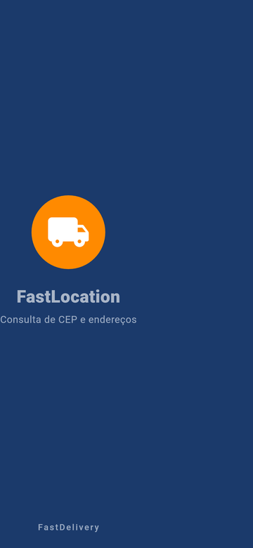
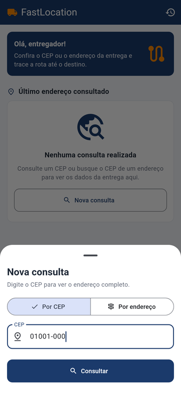
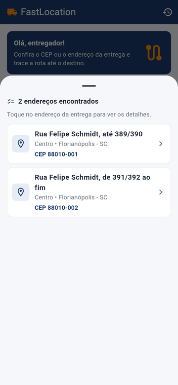

# FastLocation

Aplicativo mobile (Android e iOS) feito em Flutter para os entregadores da **FastDelivery** consultarem endereços pelo CEP e descobrirem o CEP de um endereço completo ou parcial, sem precisar ligar para a matriz.

Desafio da disciplina **Desenvolvimento de Sistemas Móveis**, por Gustavo Borges.

| Abertura | Consulta por CEP | Último endereço | Busca por endereço | Histórico |
| :---: | :---: | :---: | :---: | :---: |
|  |  |  |  |  |

> Capturas geradas a partir dos widgets do app com dados de exemplo. Outras telas (loading, endereço não encontrado e home sem consultas) estão em [`docs/screenshots`](docs/screenshots).

## Funcionalidades

| Resultado esperado | Como foi atendido |
| --- | --- |
| Comunicação externa com a API pública de CEP e endereços | API [ViaCEP](https://viacep.com.br) com Dio: `GET /ws/{cep}/json/` e `GET /ws/{UF}/{cidade}/{logradouro}/json/` |
| Armazenamento local para consultas recorrentes | Histórico no Hive com o CEP como chave; um CEP já consultado é lido do aparelho, sem nova chamada à API (funciona até sem internet) |
| Gerenciamento de estado para interfaces reativas | Stores do MobX (`HomeController` e `HistoryController`) com `Observer` nas telas e `reaction` para erros e resultados da busca |
| Componente com campos para consulta de CEP | Formulário "Nova consulta" com máscara `00000-000` e aba para busca por UF, cidade e logradouro |
| Componente com retorno dos dados consultados | Cartão do último endereço consultado (logradouro, bairro, cidade, DDD, IBGE, região) |
| Tela de loading durante a consulta externa | Camada de carregamento sobre a tela inteira enquanto a API ou a geocodificação respondem |
| Componente para resultados não encontrados | Componente de busca vazia, com mensagem própria para "endereço não encontrado" |
| Tela com o histórico de endereços consultados | Página de histórico carregada automaticamente ao abrir; tocar em um endereço o leva de volta para a home |
| Ação para traçar rota até o último endereço | O endereço é convertido em coordenadas (geocoding) e aberto no app de mapas escolhido, partindo da localização atual do aparelho |

## Estrutura do projeto

```
lib/
├── main.dart                         # main() refatorado: inicia o Hive e o AppWidget
└── src/
    ├── app_widget.dart               # MaterialApp: tema e rotas
    ├── http/dio_client.dart          # configuração do Dio (ViaCEP)
    ├── routes/app_routes.dart        # nomes das rotas
    ├── shared/
    │   ├── colors/                   # AppColors
    │   ├── components/               # loading, título de seção, mensagem
    │   ├── metrics/                  # AppMetrics (espaçamentos)
    │   └── storage/                  # HiveConfig e chaves das caixas
    └── modules/
        ├── initial/page/             # tela de abertura animada
        ├── home/
        │   ├── components/           # lista de endereços, último endereço, busca vazia, formulário
        │   ├── controller/           # HomeController (MobX)
        │   ├── model/                # AddressModel (retorno da ViaCEP) e erros
        │   ├── page/                 # HomePage
        │   ├── repositories/         # API ViaCEP, armazenamento local e geocoding
        │   └── service/              # regras de negócio (AddressService)
        └── history/
            ├── controller/           # HistoryController (MobX)
            └── page/                 # HistoryPage
```

Os arquivos `*.g.dart` (stores do MobX e adapter do Hive) são gerados pelo `build_runner` e já estão no repositório, então o projeto roda sem gerar código antes.

## Pré-requisitos

- Flutter **3.47 ou mais recente** (desenvolvido e testado com o Flutter 3.50.0 / Dart 3.14)
- Android: Android Studio ou Android SDK, com um emulador ou aparelho
- iOS: macOS com Xcode e CocoaPods

Para conferir o ambiente: `flutter doctor`.

## Como executar

```bash
git clone https://github.com/GustavoBorges130/Desenvolvimento-de-Sistemas-Moveis.git
cd Desenvolvimento-de-Sistemas-Moveis

flutter pub get
flutter run
```

Para gerar o APK de instalação no Android:

```bash
flutter build apk --release
# arquivo em build/app/outputs/flutter-apk/app-release.apk
```

Se alterar um controller do MobX ou o `AddressModel`, gere de novo o código:

```bash
dart run build_runner build --delete-conflicting-outputs
```

### Testes

```bash
flutter analyze
flutter test
```

São 49 testes, cobrindo o model, os repositórios (incluindo leitura e gravação no Hive com o adapter gerado), o service, os dois controllers e as telas (abertura, consulta por CEP, busca por endereço, não encontrado, erro e histórico).

## Como usar

1. Na home, toque em **Nova consulta**.
2. Em **Por CEP**, digite o CEP; em **Por endereço**, escolha a UF e informe a cidade e o logradouro (mínimo de 3 letras cada, regra da ViaCEP). Pode ser só parte do nome da rua.
3. Quando a busca por endereço encontra vários CEPs, escolha o da entrega na lista.
4. O endereço aparece em destaque. Toque em **Traçar rota** para abrir o app de mapas com o trajeto a partir de onde você está.
5. O ícone de relógio no topo abre o **histórico**. Tocar em um endereço do histórico o coloca de novo em destaque na home.

Para a rota funcionar, o aparelho precisa de um app de mapas instalado (Google Maps, Waze etc.). No emulador Android, use uma imagem com Google Play, porque a geocodificação usa o serviço do próprio sistema.

## Dependências

Instaladas conforme o desafio:

| Uso | Pacotes |
| --- | --- |
| HTTP | `dio: ^4.0.6` |
| Estado | `flutter_mobx: ^2.0.4`, `mobx: ^2.0.6+1` |
| Armazenamento local | `hive: ^2.1.0`, `hive_flutter: ^1.1.0`, `path: ^1.8.0`, `path_provider: ^2.0.2`, `path_provider_android: ^2.0.14`, `path_provider_ios: ^2.0.9` |
| Rota | `map_launcher: ^2.2.1+1`, `geocoding: ^2.1.1` |
| Geração de código | `mobx_codegen: ^2.0.1+3`, `build_runner: ^2.0.5`, `hive_generator: ^2.0.0` |

### Ajustes de compatibilidade

Algumas versões pedidas no desafio são de 2022 e não funcionam sozinhas no Flutter atual. Os ajustes abaixo mantêm as dependências do desafio no `pubspec.yaml`:

- **map_launcher:** a série 2.x usa a API antiga de plugins do Android (`PluginRegistry.Registrar`), removida no Flutter 3.29, e não compila. O `pubspec.yaml` mantém `map_launcher: ^2.2.1+1` e usa `dependency_overrides` para a 4.6.0, que tem a mesma API usada no app (`MapLauncher.installedMaps`, `showDirections`, `Coords`).
- **geocoding:** o `geocoding_android` 3.x compila com o Android SDK 33, abaixo do mínimo das bibliotecas AndroidX atuais. O `android/build.gradle.kts` faz essas bibliotecas usarem o mesmo `compileSdk` do app.
- **hive_generator:** só funciona com o analisador do Dart 6.x, que não entende a sintaxe `?elemento` em listas (Dart 3.8+). O código não usa essa sintaxe, e o lint que a sugere está desligado no `analysis_options.yaml`.
- **dio:** a 4.0.6 é a última da série 4.x e tem avisos de segurança corrigidos na 5.x. No app ele só faz requisições GET fixas para a ViaCEP.
- **path_provider_ios:** está descontinuado (substituído pelo `path_provider_foundation`, que o `path_provider` já usa). Foi mantido por ser exigido no desafio.

## Autor

Gustavo Borges ([@GustavoBorges130](https://github.com/GustavoBorges130))
